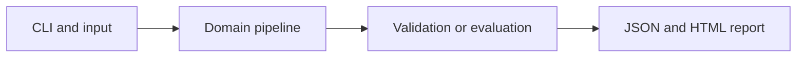

# Leakage-Aware Demand Forecasting

Forecast one step ahead using lag features and expanding-window backtesting.

**Category:** ML

**Execution:** Actual local algorithm or workflow; no external model service required.

## Run

```sh
python -m venv .venv
# Windows: .venv\Scripts\activate
# macOS/Linux: source .venv/bin/activate
python -m pip install -r requirements.txt
python app.py
python -m unittest discover -v
```

Open `results/report.html` after running. Python 3.10+ is required. Use `--help` for input and seed options.

## Architecture



## Algorithm

Construct fourteen historical lags and weekday sine/cosine features. Ridge regression uses centered training design matrices and solves a regularized linear system. Evaluate each fold using only earlier observations.

## Evaluation

Select regularization on earlier chronological folds; reserve the last 80 days as a final rolling one-step test. Compare seasonal-naive predictions from seven days earlier.

## Limitations

Every test prediction may use previously observed test values, which is valid for rolling one-step forecasts, not an 80-step open-loop forecast. The series is synthetic.

## Documentation

- [PDF project guide](PROJECT_GUIDE.pdf)
- [Editable guide](GUIDE.md)
- [Model and system card](MODEL_CARD.md)
- [Measured results](results/metrics.json)
- [Test output](TEST_RESULTS.txt)

## Extend it

Add real demand data, horizon-specific evaluation, holidays, prediction intervals and an explicit multi-step forecasting mode.

AI-assisted educational project with synthetic data. Review, customize and explain your own contribution accurately. MIT license.
